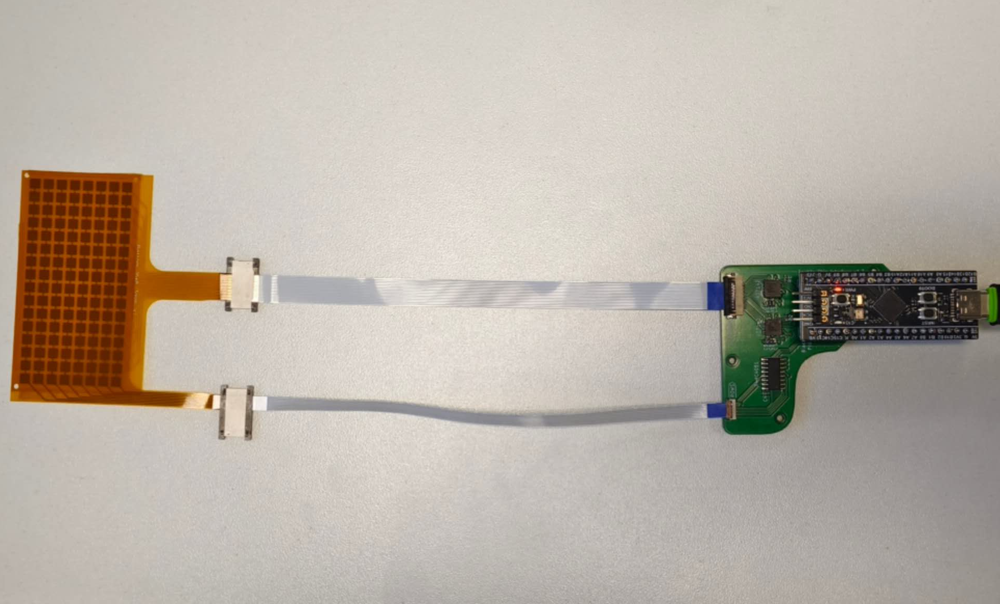
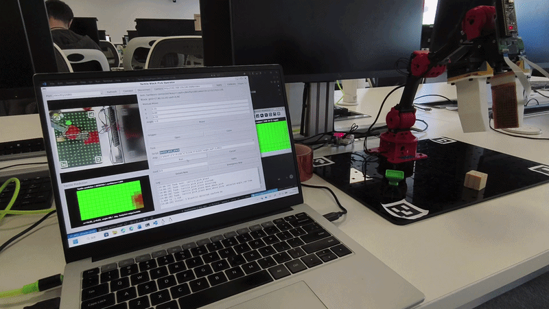

# Tactile-Skin

This project focuses on creating a thin, flexible tactile skin that measures mechanical pressure, rather than just proximity. This repository contains the firmware and signal processing logic to convert physical deformation and capacitance into usable digital data and the schematics and Gerber files for the requisite hardware.

## Sensor Hardware

The tactile skin is built around a 16 x 8 capacitive matrix sensor. Each taxel in the matrix responds to local pressure-induced deformation, producing a change in capacitance that can be mapped into a two-dimensional tactile image. This layout provides a compact sensing surface while preserving enough spatial resolution to estimate where and how an object contacts the skin.

The signal collection board interfaces the sensor matrix with AD7142 capacitance-to-digital converters and an STM32F411CEU6 microcontroller. The AD7142 devices convert small capacitance changes from the tactile array into digital measurements, while the STM32 firmware coordinates sensor scanning, data acquisition, packet formatting, and USB serial transmission to the host computer. Together, the flexible sensor and collection board form a complete tactile feedback module for robotic manipulation experiments.

## Tactile Sensor Application Demo

This demo shows a robot using tactile feedback to grasp and place a block more accurately. When the robot picks up the block, the tactile contact pattern is visualised on the computer as a red region on the green heat map. The robot uses this tactile pattern to estimate an offset for the final placement position, allowing it to compensate when the YOLO vision prediction is inaccurate or when the block is disturbed after detection.

In the first trial, the robot detects the block with computer vision, picks it up, and places it in the holder. In the second trial, the block is manually moved after YOLO detection, but the robot still places it successfully because the tactile feedback corrects the placement position during the task.

## Repository Structure

### Firmware
The core software running on the microcontroller, built using PlatformIO. It handles high-speed analog acquisition from the skin matrix and packs it for serial transmission.
* `/src`: Main firmware source files (`.c` & `.cpp`).
* `/include`: Global header files (`.h`).
* `platformio.ini`: The core PlatformIO configuration script.

### Tools (`/tools`)
* `/common`: Shared, hardware-agnostic C++ data engine containing the core signal processing logic and GUI rendering requirements.
* `/visualiser`: A high-performance, cross-platform desktop utility built with Raylib. Features include:
  * **Multi-Instance Isolation:** Run multiple parallel instances side-by-side to monitor independent microcontrollers simultaneously.
  * **Dynamic Port Mapping:** Hot-swap hardware link contexts on-the-fly via an integrated UI selector.
  * **Zero-Lag Simulation Mode:** Automated fallback to a high-fidelity Gaussian simulation model when running offline.
  * **Dynamic Profile Loading:** Real-time parameter loading via local `.ini` configuration files to calibrate individual sensor variations dynamically without recompiling the codebase.

### Hardware (`/hardware`)
* `/fpc`: Flexible Printed Circuit manufacturing files.
  * Complete production-ready Gerber packages.
* `/pcb`: Main rigid Printed Circuit Board design histories.
  * Main interface between the sensor and microcontroller.

## Contribution Guidelines

To keep the project history clean and professional, please follow these conventions:

### Git Commit Prefixes
Use **Conventional Commits**. Start every commit message with one of these:
* **`Docs:`** Documentation changes or code comments (e.g., `Docs: update README`).
* **`Feat:`** New features or logic (e.g., `Feat: implementation of scan loop`).
* **`Fix:`** Bug fixes (e.g., `Fix: corrected index overflow`).
* **`Chore:`** Maintenance tasks, library imports, or project scaffolding (e.g., `Chore: import USB core libraries`).
